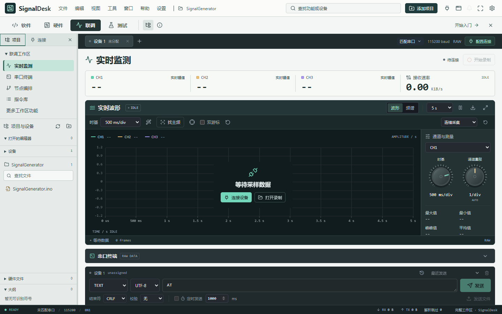
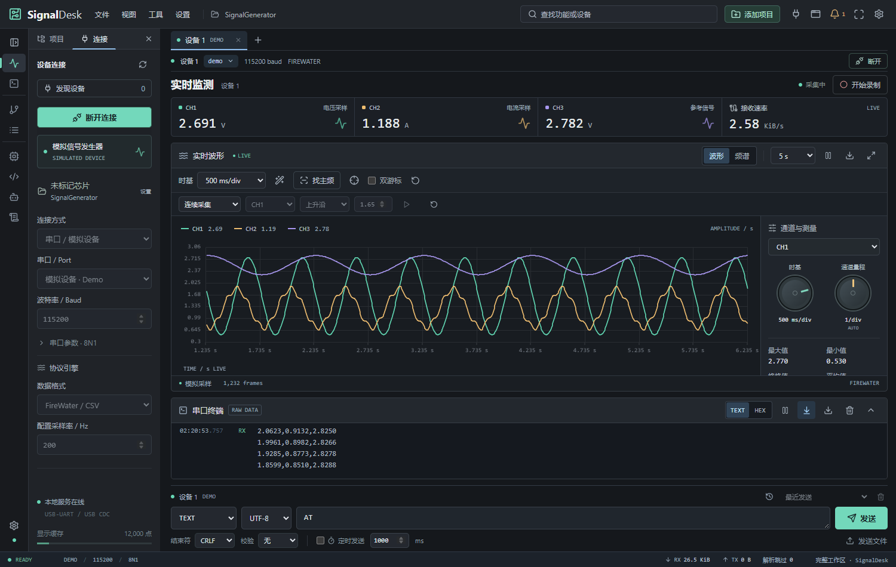
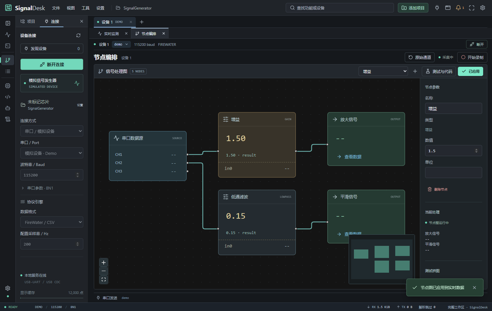
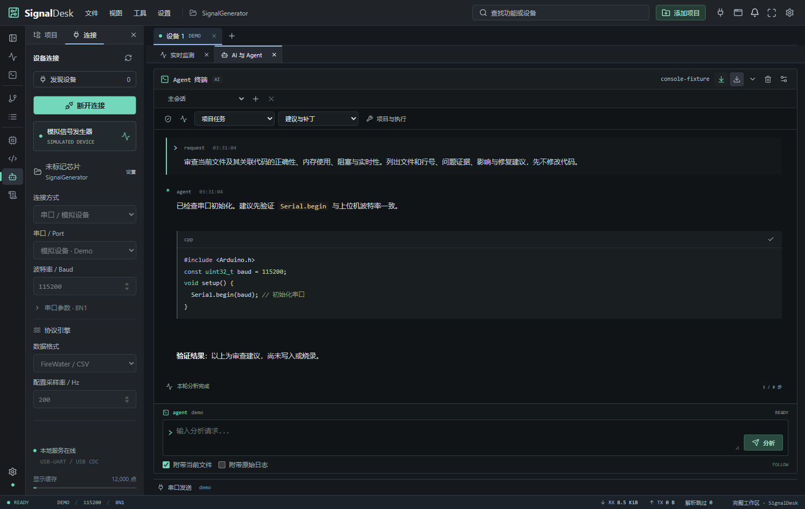

# SignalDesk

### 嵌入式开发与调试工作台

SignalDesk 将设备连接、实时数据、工程源码、编译测试和 AI 辅助调试整合到一个本地工作区，面向 ESP32、STM32、Arduino 及其他嵌入式项目的日常开发与联调。

你可以为每块开发板绑定工程，同时查看串口日志、波形、源码和 Agent 分析结果，并通过可选权限连接外部 Agent。

**当前版本：0.1.5 · Windows x64 · 持续开发中**

[快速开始](#快速开始) · [功能概览](#功能概览) · [开发与构建](#开发与构建) · [文档](#文档)



> 默认离线启动，不自动连接真实设备，也不自动生成模拟数据。演示信号需要手动启用。当前主要验证环境为 Windows x64，尚未提供 macOS / Linux 发行包。

## 功能概览

| 模块 | 功能 |
| --- | --- |
| IDE 工作区 | 一体化标题栏、精简/完整模式、工程文件树、工作页标签、可调整侧栏、Agent 分栏、底部输出、独立工具窗口 |
| 项目与设备 | 工程目录识别、串口热插拔检测、新设备弹窗、USB 身份绑定、芯片与开发板线索、最多 8 个设备并行采集 |
| 串口终端 | 文本/HEX/ASCII+HEX 混发、编码与时间戳、接收搜索与高亮、收发计数、文件发送、报文保存 |
| 指令库 | 自由分组、批量发送、定时发送、间隔与循环、SSCOM/JSON 导入导出、CRC16/SUM8 校验 |
| 波形与频谱 | 多通道波形、时基/量程旋钮、缩放暂停、双游标、触发与单次捕获、FFT、主频查找、CSV 导出 |
| 数据测量 | 最值、均值、峰峰值、RMS、过零估频、周期、频谱峰值保持 |
| 节点与脚本 | 数学运算、滤波、传感器换算、合成信号、实时输入/结果显示、测试拼图、Arduino/C99 测试代码生成 |
| 自定义控件 | QuickJS 受限 JavaScript、模板、实时预览、数值、进度条、指示灯、按钮和曲线 |
| 协议与仪器 | CSV/FireWater、JustFloat、JSON、自定义二进制帧、Modbus RTU 报文分析、串口/TCP SCPI 指令 |
| 蓝牙与 CAN | 系统配对后的蓝牙 SPP 虚拟串口；经典 CAN 日志导入、负载区间估算与 ID/周期统计 |
| 姿态与模型 | Euler/四元数姿态、开发板参考模型、PCB 模型导入、GLB 导出、元件与引脚信息、传感器数据绑定 |
| 测试与报警 | 自动发送/等待/断言、阈值、突变、超时与断连报警、通知、确认与恢复记录 |
| 录制与日志 | 原始 RX/TX 录制、导入回放、操作与错误日志、设备筛选、日志及报告导出 |
| 源码与编译 | C/C++/Arduino 语法高亮、折叠、大纲、搜索跳转、工具链编译、测试结果、诊断定位和产物清单 |
| AI 与 Agent | 本地项目体检、数据分析、源码审查、优化提案、多会话、只读子代理、修改前后对照与历史记录 |
| 外部接口 | MCP stdio、CLI、本地 HTTP API、设备/工程绑定、连接开关、独立的读写/发送/工具链权限 |

### 波形与节点预览

<details>
<summary>查看实时波形与测量界面</summary>



</details>

<details>
<summary>查看节点编排界面</summary>



</details>

预览中的波形来自演示信号，节点和设备信息用于展示软件功能，不代表对应开发板已经完成实物验证。

### Agent 终端



该图使用本机模型协议夹具展示界面，未调用线上模型；已有工程、权限和修改记录继续使用原有流程。

## 快速开始

### 使用 Windows 程序

从 [GitHub Releases 下载发行版](https://github.com/flxd123212/SignalDesk/releases/latest)，也可以按下文自行构建。

| 文件 | 用途 |
| --- | --- |
| `SignalDesk-Setup-0.1.3-x64.exe` | 安装版，可选择安装目录，创建桌面和开始菜单快捷方式 |
| `SignalDesk-Portable-0.1.3-x64.exe` | 单文件免安装版，启动时解压运行环境 |

两种版本均自带 Electron/Node.js，无需另装 Node.js。USB 串口驱动、编译器、SDK、器件包和下载器软件需要根据目标设备单独安装。

免安装版的设置仍保存在当前用户目录，不是将所有数据放在 EXE 旁的便携数据模式。当前发行文件未做代码签名。

### 第一次连接开发板

1. 打开软件，将开发板连接电脑，确认系统已识别出串口。
2. 从“发现新设备”弹窗选择端口，或点击顶部插头按钮手动打开设备列表。
3. 选择已有工程或新建设备，核对波特率和数据格式，再选择“仅绑定”或“绑定并连接”。
4. 通过“添加项目”选择源码目录，核对识别出的构建目标、主文件和设备信息。
5. 在串口终端查看原始数据；需要波形时选择与固件输出一致的解析协议和采样率。

插入新串口时的软件检测不会自动发送识别指令。USB 转串口芯片的型号不等于目标 MCU 型号；没有充分信息时会显示待确认。

### 从源码运行

需要 Node.js 22.12 或更高版本、npm，以及下载依赖所需的网络连接。在包含 `package.json` 的项目根目录运行：

```powershell
npm ci
node node_modules/electron/install.js
npm run build
npm start
```

其他启动方式：

```powershell
# 浏览器开发模式
npm run dev

# 使用已经构建的前端
npm run serve
```

浏览器服务默认地址为 `http://127.0.0.1:4780`。如果端口被占用，以终端输出的实际地址为准。浏览器模式仍由本机 Node.js 服务访问串口和工程文件。

## 工程与工具链

支持识别 Arduino、PlatformIO、ESP-IDF、CMake、STM32CubeMX、Keil 和 IAR 工程中的配置线索。编译能力取决于已经安装的工具链及工程自身配置。

| 工具链 | 当前接入范围 |
| --- | --- |
| Arduino CLI | 工程编译、开发板 FQBN 配置 |
| PlatformIO | 环境选择、编译、native 测试、板端测试固件编译 |
| ESP-IDF | 构建命令；需使用已经激活的 SDK/Python 环境 |
| CMake / CTest | 配置、编译、本机测试、诊断和结果记录 |
| GCC 交叉编译 | ARM/RISC-V 编译器识别、工程内 CMake 工具链、Ninja、ELF 架构与产物查看 |
| Keil µVision | 工程 Target 识别、UV4 编译、下载任务预览与确认 |
| IAR | `.ewp` 配置识别、IarBuild 编译；未提供通用 C-SPY 下载配置 |

芯片下载另接入 esptool、STM32CubeProgrammer CLI 和 avrdude 等外部工具。芯片目录中的型号数量不代表所有型号都具备相同的编译或烧录能力。

工程可通过根目录的 `signaldesk.json` 补充标识和串口参数：

```json
{
  "version": 1,
  "name": "S3 Telemetry",
  "chip": "ESP32-S3",
  "board": "ESP32-S3-DevKitC-1",
  "serial": {
    "baudRate": 230400,
    "protocol": "firewater",
    "sampleRate": 200
  }
}
```

交叉编译需要工程提供正确的 CPU/ABI、链接脚本、启动文件与 SDK。编译成功不代表固件已经在开发板上运行通过。

## AI 与外部 Agent

本地项目体检和统计分析无需模型接口。AI 模式通过设置页配置服务地址、API 格式、模型和密钥，支持连接测试与模型列表读取。

已实现 Chat Completions、Responses、Anthropic Messages 和 Gemini generateContent 四类协议适配，并提供服务商及本地模型服务预设。预设是配置入口，具体模型的工具调用能力仍需连接测试确认。

- 内置 Agent 的修改、串口发送与构建操作默认通过提案确认；修改前后代码、行号、备份和记录可以追踪。
- 每个设备拥有独立会话；内置子代理执行数据诊断、固件审查和验证建议等只读任务。
- 外部 Agent 可通过 MCP、CLI 或 HTTP 接入；读取、提建议、直接写文件、发送串口指令和执行工具链分别授权。
- 直接写入、发送和执行权限默认关闭。外部连接没有时间到期选项，通过连接/断开控制；服务重启后令牌失效。
- 桌面版通过系统安全存储加密保存 API Key、会话和模型续接上下文，重启后自动恢复。独立 Node 服务保存非密钥配置及文本会话，不将密钥或私有推理明文落盘。将源码交给远程模型分析时，所选内容会发送到配置的服务。

这些授权约束 SignalDesk 提供的接口，不限制外部 Agent 自身的其他工具。配置示例与权限详情见 [外部 Agent 文档](docs/EXTERNAL_AGENTS.md)。

## 开发与构建

前端使用 React、TypeScript 和 Vite；桌面容器使用 Electron；本地服务使用 Node.js、Express、WebSocket 与 serialport。图表使用 uPlot/fft.js，节点使用 React Flow，代码视图使用 CodeMirror，三维视图使用 Three.js，自定义控件执行使用 QuickJS。

```text
serial-workbench/
├── src/                 前端页面、编辑器和仪器视图
├── server/              串口、工程、工具链、Agent 与本地接口
├── shared/              前后端共享定义与处理逻辑
├── desktop/             Electron 主进程、预加载和桌面资源
├── firmware-examples/   固件与交叉编译示例
├── public/              静态资源和模型
├── tests/               单元、集成、浏览器与桌面测试
├── tools/               构建及发布辅助脚本
└── docs/                使用说明、验证记录和首页截图
```

构建 Windows x64 发行文件：

```powershell
npm run package:win
npm run test:package
node tests/portable-smoke.mjs
node tools/release-manifest.mjs
```

产物位于 `release/`，包含安装包、免安装 EXE、完整程序目录和校验清单。分发 `win-unpacked` 时必须保留完整目录；单文件分发使用 Portable EXE。EXE 和校验文件可作为 GitHub Release 附件发布。

常用验证命令：

```powershell
npm test
npm run build
npm run test:ui
npm run test:desktop
```

浏览器测试默认使用 Microsoft Edge；部分编译测试依赖本机工具链。提交问题时请附软件版本、系统、设备/芯片、连接方式、复现步骤和相关日志，不要提交密钥或外部连接令牌。

### 0.1.4 Agent 工作区

修复每次启动都要重新配置 API 的问题。桌面版加密保存配置、多设备会话、完整工具上下文和任务计划，恢复上次选择；启动不自动执行未完成任务。会话保留最近最多 300 条、512 KiB 可见记录；模型历史仍受三轮、128000 字符边界约束。外部 Agent 的历史以只读会话恢复，连接令牌不保存。

内置 Agent 提供 18 个工具，新增项目概览、按文件名查找、按行读源码、编译诊断、修改记录与差异查询、受控报文查询、任务计划和局部代码补丁。界面支持工具参数/结果/耗时、源码位置跳转、计划进度、会话搜索和工具箱。增加 `/plan`、`/continue`、`/diagnose`、`/changes` 快捷任务。

消息、菜单、弹窗和工具状态增加轻量动画，可在“设置 → 外观与布局 → 界面动画”关闭，并遵循系统减少动态效果偏好。持久化机制、恢复边界与验证命令见 [Agent 运行说明](docs/AGENT_RUNTIME.md)。

### 0.1.3 Agent 更新

每条回复可展开请求模型与接口返回模型、地址、请求 ID、耗时和 token 用量，支持复制与导出。生成文本的自我介绍不再作为模型来源依据。四种接口完整保留工具历史，切换模型时隔离上下文；可查看上下文用量并独立重置，保留会话记录与待执行提案。

DeepSeek 支持 Chat、Responses、Anthropic 三种入口，协议与地址联动，并分别适配思考模式。主会话保留子代理的结果与失败状态用于后续追问。134 项后台回归和 3 项 Agent 界面专项通过。进一步研究与已实现范围见 [OpenCode Agent 研究记录](docs/OPENCODE_AGENT_REVIEW.md)。

### 0.1.2 Agent 更新

修复 DeepSeek 仅返回推理、没有最终正文的问题，加入快速回答与深度思考选择。Agent 支持只读分析、源码搜索与行号、构建结果读取、运行阶段显示、有限自动重试、停止与手动恢复、重复工具保护，以及达到步数上限后的进度总结。已有的写文件、串口和工具链权限继续生效。

终端式界面提供连续输出、代码块高亮与复制、斜杠快捷任务、输出跟随开关和 Markdown 会话导出。

后台回归 123 项通过，包含实际 C 编译与 CTest。模型适配通过本机 HTTP 夹具验证，尚未使用真实 API Key 调用线上模型。详见 [Agent 运行说明](docs/AGENT_RUNTIME.md)。

### 0.1.1 验证状态（历史记录）

| 检查 | 记录 |
| --- | --- |
| TypeScript / Vite 构建 | 通过 |
| 后台测试 | 109 项通过，0 跳过 |
| 完整界面回归 | 45 项中 44 项通过；1 项连接/截图中断，尚未获得完整通过结果 |
| 桌面与发行程序 | 一体化标题栏、默认离线、安装版和免安装版启动验证通过 |
| 真实硬件 | 串口热插拔主要使用 Mock 验证；尚未完成真实开发板下载与持续采样验证 |

以上为 2026-11-15 的本机验证记录，不是 GitHub CI 状态。详细证据与测试环境限制见 [验证记录](docs/VALIDATION.md)。

## 当前边界

- 示波器和频谱功能分析的是设备上传的数据，不能替代硬件采样前端。采样率配置、丢帧和采样均匀性会影响时间轴、频率及 FFT 结果。
- 波特率支持标准选项和 `50..12000000` 范围内的整数配置，实际可用速度由硬件、驱动与链路决定。
- 蓝牙支持 SPP 虚拟串口，未实现 BLE GATT；CAN 当前为日志离线分析，未实现实时 USB-CAN 或 CAN FD。
- 仪器控制提供串口和原始 TCP SCPI，未实现 VISA、USB-TMC、VXI-11 或 HiSLIP。
- 文件树中的工程源码视图目前为只读浏览。可通过 Agent 审查和确认修改，也可使用外部编辑器；尚无完整 C/C++ 语言服务器或 SWD/GDB 源级调试。
- 开发板参考模型存在几何近似。根据任意原理图、PCB 图片和源码自动还原可仿真电路，以及自动确定接线故障，仍处于研究阶段。

## 文档

| 内容 | 文档 |
| --- | --- |
| 完整使用、设备配置、日志与数据存储 | [使用手册](docs/USER_GUIDE.md) |
| Windows 打包、运行资源与安装验证 | [Windows 发行说明](docs/WINDOWS_RELEASE.md) |
| 模型接口与诊断 | [AI 接口说明](docs/AI_PROVIDERS.md) |
| MCP、CLI、HTTP 与权限 | [外部 Agent 接入](docs/EXTERNAL_AGENTS.md) |
| 波形、频谱、CAN、脚本与控件 | [仪器功能说明](docs/INSTRUMENTS.md) |
| PCB 导出模型与精度边界 | [PCB 样例](docs/PCB_EXPORT_SAMPLE.md) / [ESP32-S3 模型](docs/ESP32_S3_MODEL.md) |
| 电路、固件与数据联动的后续方向 | [可行性研究](docs/CIRCUIT_LINK_RESEARCH.md) |
| 测试证据与未验证项 | [验证记录](docs/VALIDATION.md) |

## 0.1.5 动画与个性化

- 电路信号启动动画，按界面、本地服务和工作区的实际状态显示进度，支持跳过、Esc 退出和设置内预览。
- 页面、侧栏、标签、菜单、按钮、录制和报警增加统一动效；可选柔和/灵动，也可全部关闭，遵循系统减少动态效果设置。
- “设置 → 主题与背景”支持任意 HEX/取色器主题色、纯色背景、本地 PNG/JPG/WebP 背景、填充方式、模糊和遮罩调节。
- 背景图片压缩后单独保存在本机，主题、图片及动画偏好重启恢复；不会上传背景，也不会改变设备连接和 Agent 权限。

## 参考与许可

工作区布局参考了常见 IDE 的操作方式；串口数据可视化与节点设计研究记录见 [Lissio 参考说明](docs/REFERENCE_REVIEW.md)。本项目没有复制该项目的产品源码、品牌或图片资产。

仓库根目录目前尚未提供项目级 `LICENSE` 文件，本 README 不指定开源许可证。第三方依赖及模型资源的原有许可说明需保留；RoyalBlue54L PCB 样例的出处见 [NOTICE](public/models/royalblue54l/NOTICE.md) 和 [许可证文件](public/models/royalblue54l/LICENSE.txt)。
